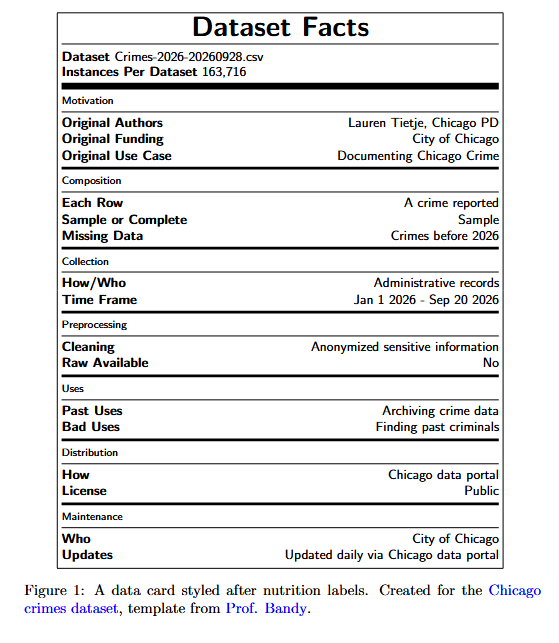
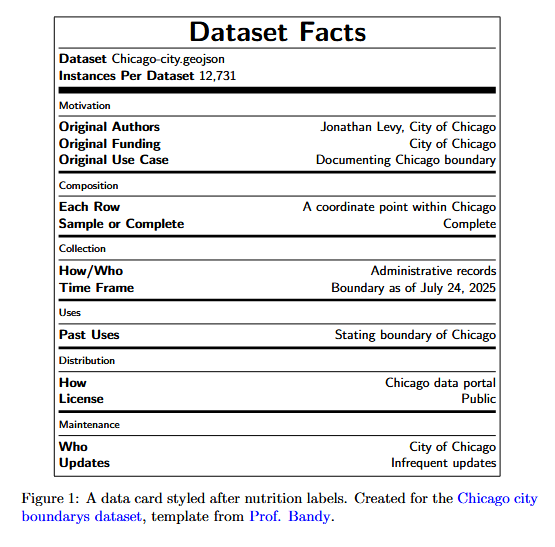
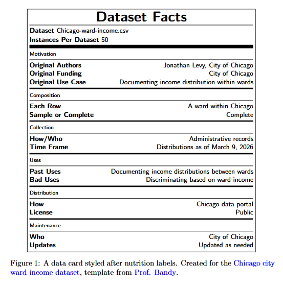

# Datasheets

- Crimes\_-_2026_20260928.csv 
  

* Chcago-city.geojson 
  

* Chicago-ward-income.csv 
  

# Scope

- Does the presence of flock cameras in areas lower traffic violations?
  - Target population are traffic violations within the city of chicago starting in July 2022
  - Access frame are cameras reported in cameras.geojson and traffic violations reported by CPD in our time frame
  - Sample is traffic violations through Septermber 2026 joined to cameras in cameras.geojson.
- Do flock cameras actually help reduce crime
  - Target population are reported crimes within the city of chicago starting in July 2022
  - Access frame are cameras reported in cameras.geojson and crimes reported by CPD in our time frame
  - Sample is crimes through Septermber 2026 joined to cameras in cameras.geojson.

  # Access and Reuse

  ## Using FAIR (Findable, Accessible, Interoperable, Reusable)

- Crimes\_-_2026_20260928.csv 
  - [Link to database](https://data.cityofchicago.org/Public-Safety/Crimes-2026/f6bk-yv3r/about_data)
  - Downloaded September 20th 2026 in .csv format. Dataset is open to the public

* Chcago-city.geojson 
  - [Link to database](https://data.cityofchicago.org/Facilities-Geographic-Boundaries/Boundaries-City/qqq8-j68g/about_data)
  - Downloaded September 2025 in .geojson format. Dataset is open to the public

* Chicago-ward-income.csv 
  - [Link to database](https://data.cityofchicago.org/Community-Economic-Development/ACS-5-Year-Data-by-Ward-Most-Recent-Year/k5pk-wpt9/about_data)
  - Downloaded dataset pertaining to 2023 data in .csv format. Dataset is open to the public

- cameras.geojson 
  - [Link to database (click on share in top right -> download geojson)](https://maps.deflock.org/?lat=39.8283&lng=-98.5795&zoom=4.00)
  - Downloaded September 20th 2026 in .geojson format. Dataset is open to the public

* red_light_100000.csv 
  - [Link to database](https://data.cityofchicago.org/Transportation/Red-Light-Camera-Violations/spqx-js37/about_data)
  - Downloaded September 2025 in .csv format. Dataset is open to the public

* speed_violations_150000.csv 
  - [Link to database](https://data.cityofchicago.org/Transportation/Speed-Camera-Violations/hhkd-xvj4/about_data)
  - Downloaded September 2025 in .csv format. Dataset is open to the public
