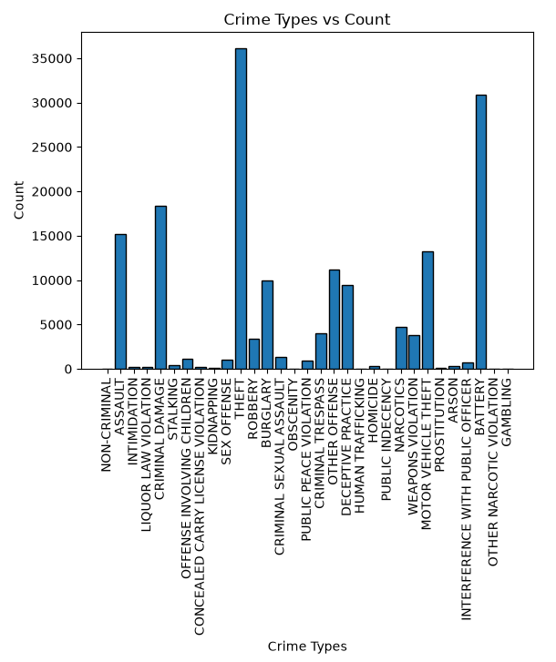
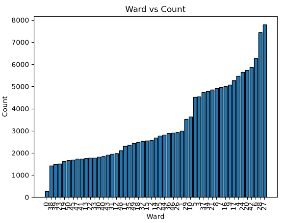
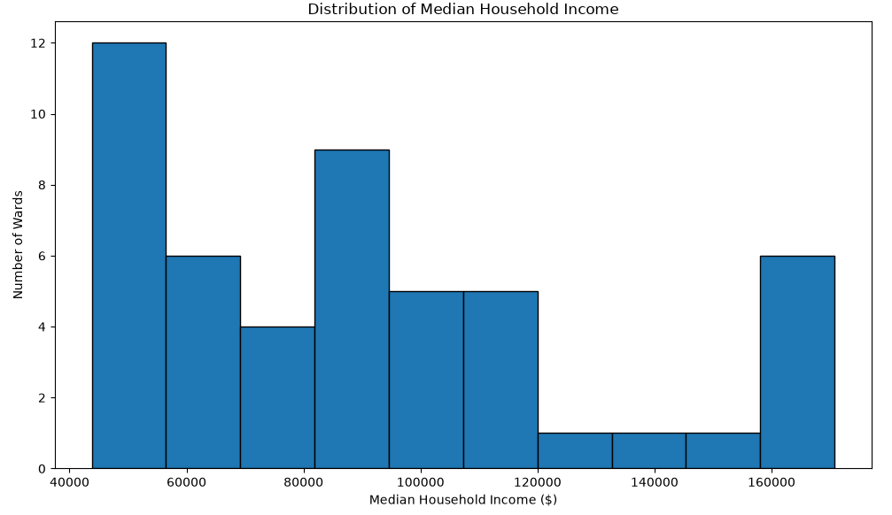
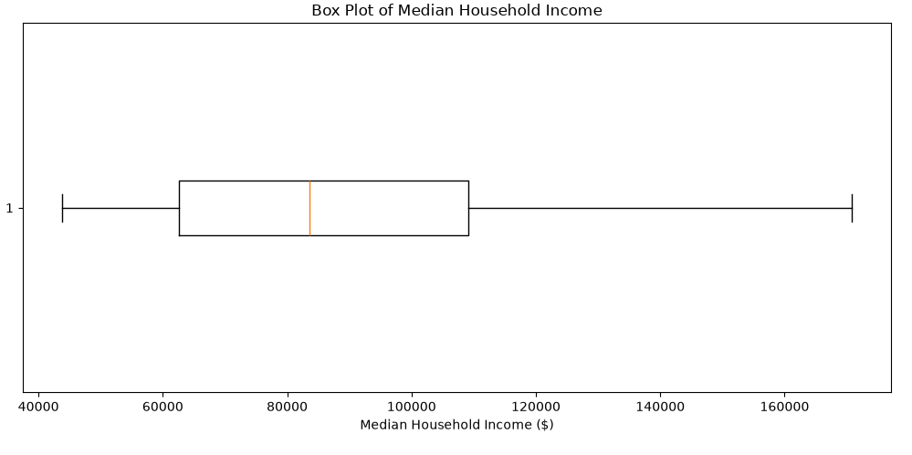
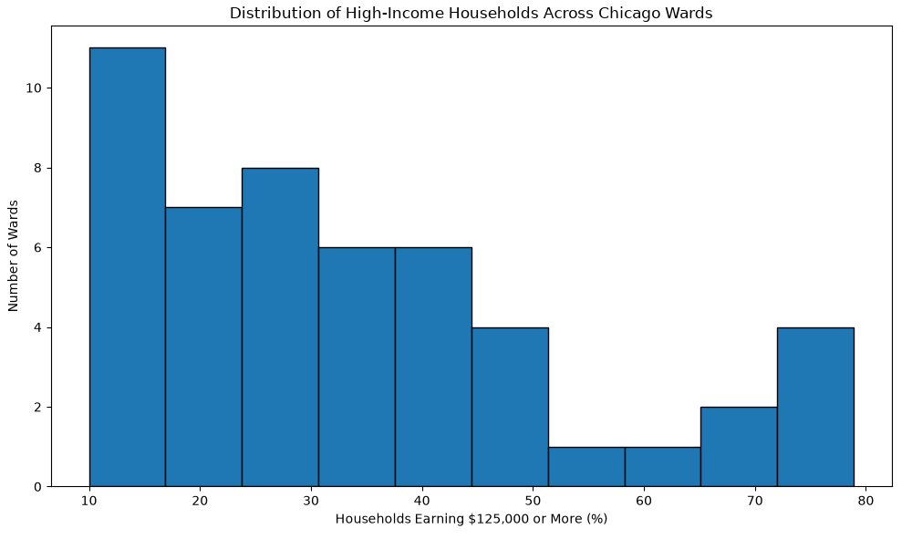
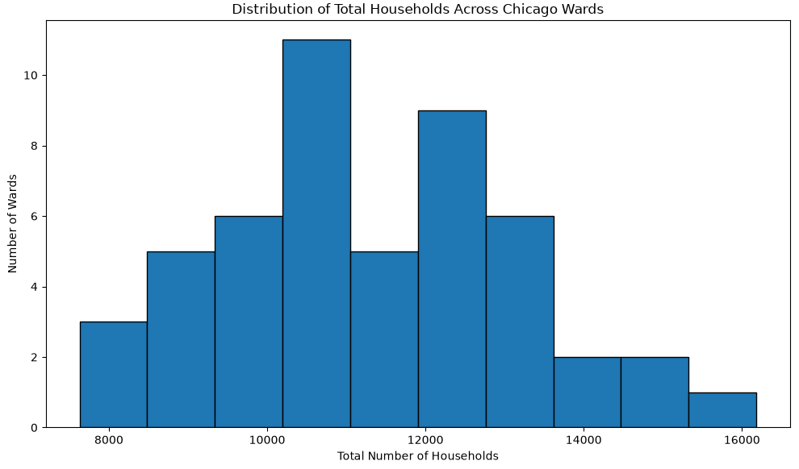
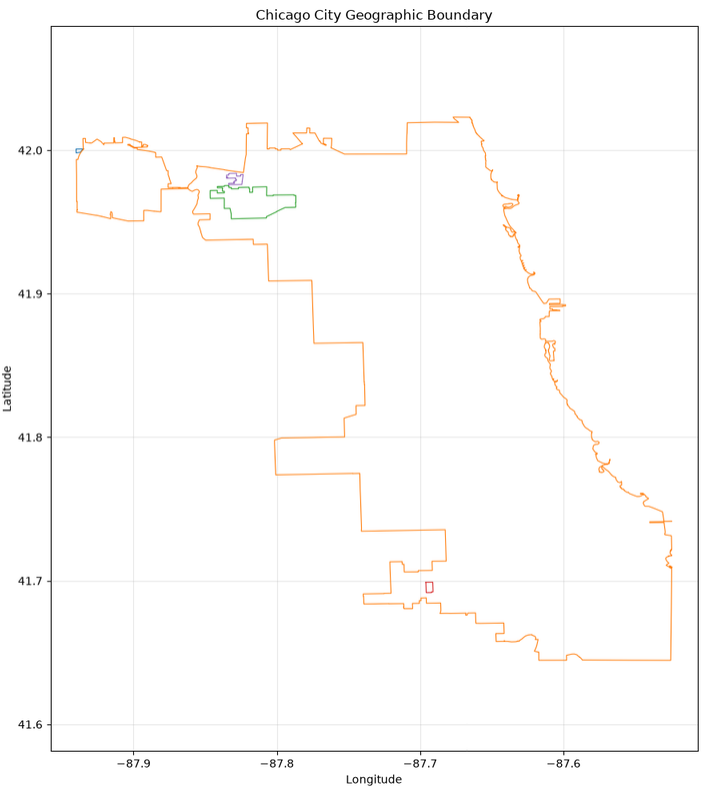
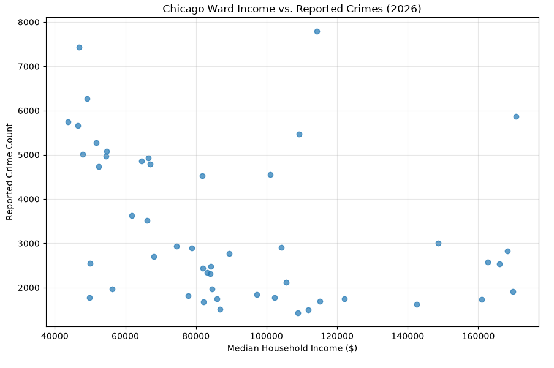
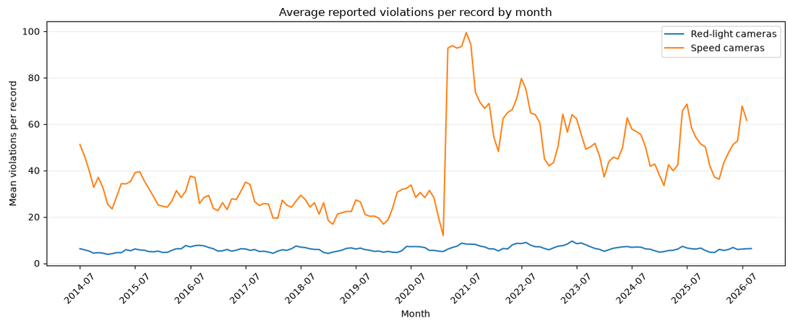

# Profiles of primary datasets

crimes.csv:

- shape: 167,464 rows and 22 columns consisting of
  - ID, int
  - Case Number, str
  - Date, str
  - Block, str
  - IUCR, str
  - Primary Type, str
  - Description, str
  - Location Description, str
  - Arrest, bool
  - Domestic, bool
  - Beat, int
  - District, int
  - Ward, int
  - Community Area, int
  - FBI Code, str
  - X Coordinate, int
  - Y Coordinate, int
  - Year, int
  - Updated On, str
  - Latitude, float
  - Longitude, float
  - Location, str
- Null Counts:
  - Location Description: 758
  - Community Area: 1
  - X Coordinate: 304
  - Y Coordinate: 304
  - Latitude: 304
  - Longitude: 304
  - Location: 304

chicago-ward-income.csv:

- shape: 50 rows and 10 columns consisting of
  - ward, int
  - acs_year, int
  - households_under_25k, int
  - households_25k_to_50k, int
  - households_50k_to_75k, int
  - households_75k_to_125k, int
  - households_125k_plus, int
  - households_total, int
  - pct_households_125k_plus, float
  - median_household_income_est, int
- Null Counts:
  - None

chicago-city.geojsonL

- shape: 4 rows consisting of
  - feature_id, int
  - geometry_type, int
  - properties_count, int
  - has_geometry, int
- Null Counts:
  - None

# Anomalies

crimes.csv:

- 304 crimes reported don't have a location associated with the crime. These crimes will be dropped from the table

chicago-ward-income.csv:

I(Neel) checked the dataset for missing values, duplicate records, invalid ward numbers, negative household counts, and incorrect income or percentage values.

The results showed no missing values or duplicate records. All ward numbers were within the valid range of 1 to 50, and there were no negative household counts or median household income values.

I(Neel) also checked whether the household counts across income categories matched the reported total households. No inconsistencies were found.

Overall, no anomalies were identified in these checks, so no rows were removed or modified. The original data was kept for further analysis

chicago-city.geojson

I(Neel) checked the Chicago City GeoJSON dataset for missing geometry, duplicate features, invalid coordinates, and problems with polygon boundaries.

The dataset contains 12,731 coordinate points across 5 polygon rings. There were no missing geometries, duplicate features, invalid coordinates, or unclosed polygon rings. All polygon rings also contained at least four points.

However, I(Neel) found 156 consecutive duplicate coordinate points. These may be redundant vertices in the geographic boundary, but they do not necessarily make the geometry invalid.

I(Neel) decided to leave these points unchanged and flag them rather than remove them, since modifying the coordinates could affect the original geographic boundary. No features or coordinate points were removed during this analysis.

# Shapes of key distributions

crimes.csv

The Crime Types vs Count bar chart is showing the different type of crimes identified by the city of Chicago and their frequency in the 2026 crimes database. There are 167474 crimes divided among 31 different types of crimes. The majority (67.93%) of crimes are classified as one of the top 5 crime types (theft, battery, criminal damage, assault, and motor vehicle theft). Leaving the remanding 26 groups to account for 32.07% of the remaining crimes.

The Ward vs Coount bar chart displays the wards in Chicago and the amount of crimes reported within them. In total there are 167,474 crimes divided among 51 wards. Unlike the Crime Type vs Count bar chart and other charts seen in out other datasets the jumps between wards isn't as drastic. The bar chart shows a gradual progression in wards with higher crimes.

chcago-ward-income.csv

The histogram shows that median household income varies considerably across Chicago's 50 wards. Most wards have median household incomes between approximately $45,000 and $120,000, while a smaller number have incomes above $150,000.

The average estimated median household income is around $91,103. The distribution appears somewhat right-skewed, with a few wards having much higher incomes than the others.

This suggests that there are noticeable economic differences across Chicago wards, which could be useful when studying how crime patterns vary between areas.

The box plot shows that the median household income across Chicago wards is approximately 83,000 dollars. The middle 50% of wards have median household incomes between roughly 63,000 and 109,000 dollars.

The income values range from approximately 44,000 to 171,000 dollars, showing a considerable difference between the lowest-income and highest-income wards.

The upper whisker is longer than the lower whisker, suggesting that incomes are more spread out toward the higher end. No statistical outliers were identified by the box plot.

The histogram shows that the percentage of households earning 125,000 dollars or more varies considerably across Chicago's 50 wards.

Most wards have approximately 10% to 45% of households in this income category, while a few wards have percentages above 70%.

The average percentage is approximately 34.4%. The distribution is right-skewed, with most wards concentrated at lower percentages and fewer wards having very high percentages.

This suggests that high-income households are not distributed evenly across Chicago wards, which could be useful when comparing socioeconomic conditions with crime patterns.

The histogram shows how the total number of households varies across Chicago's 50 wards.

Most wards have approximately 9,000 to 13,500 households, with an average of around 11,317 households per ward.

The distribution is roughly bell-shaped with a slight right tail. A few wards have more than 14,000 households, while some have fewer than 9,000.

Overall, the number of households varies across wards, which is important when comparing crime patterns because wards with more households may naturally have more reported crimes.

chicago-city.json:

The plot shows Chicago's geographic boundary using latitude and longitude coordinates. The smaller shapes represent additional polygon areas in the dataset.

This map helps us understand Chicago's geographic coverage and can be useful for analyzing crime and Flock camera locations.

# Relationships plotted and so what/next

Relationship between ward income and crime counts:

Observations:
The scatter plot compares median household income with reported crime counts across Chicago's 50 wards.

The Pearson correlation coefficient is -0.34, indicating a weak-to-moderate negative relationship. This suggests that wards with higher median household incomes tend to have fewer reported crimes, although there are several exceptions.

The relationship is not strong, and income alone cannot explain differences in crime counts.

These findings do not establish causation. Crime counts are not adjusted for population, and the income estimates are from 2023 while the crime records are from 2026
So What?:
Our analysis found a weak-to-moderate negative correlation (-0.34) between median household income and reported crime counts across Chicago's 50 wards.

This finding is relevant to our research because differences in neighborhood income may be associated with differences in reported crime. When examining whether Flock cameras help reduce crime, we should consider other factors, such as income, rather than assuming that differences in crime counts are caused by camera presence.

However, our analysis does not directly measure the effectiveness of Flock cameras. Further analysis is needed to examine camera locations, crime rates, and changes in crime over time.
What's Next?:
Our analysis found a weak-to-moderate negative relationship between median household income and reported crime counts across Chicago's 50 wards.

However, there are several limitations. The income data is from 2023, while the crime data is from part of 2026. We also used total reported crime counts rather than crime rates adjusted for population.

For future analysis, we could:

    Compare Flock camera locations with crime patterns across Chicago wards.
    Calculate crime rates using population data to make comparisons between wards more meaningful.
    Examine crime trends before and after Flock camera installation, if installation dates are available.
    Investigate whether neighborhood income is associated with camera placement.

Based on these findings, we could refine our research question to:

"How is Flock camera presence associated with reported crime patterns across Chicago neighborhoods, after considering differences in neighborhood income and population?"

This revised question would help us investigate the relationship between cameras and crime while considering other factors that may influence the results.

Traffic Violations

Information:
The speed-camera line is usually higher and changes more sharply from month to month than the red-light-camera line. In the data shown, the speed-camera average ranges from about 12 violations per record in February 2021 to about 99 in July 2021. The red-light-camera average is steadier, ranging from about 3.8 in January 2015 to about 9.5 in June 2023. Some ups and downs are expected because traffic and enforcement can change with the season. However, the July 2021 speed-camera peak surprised me. The average also appears higher from 2021 onward than it was through 2020. A change that large might reflect a real change in traffic or enforcement, but it could also be caused by changes in the records included in the dataset, camera coverage, or how violations were reported. I would not assume the increase is a direct change in how people drive without checking these possibilities.

The graph uses data from the Chicago Data Portal. The dataset describes red-light and speed-camera violations, and it is not clear whether or how Flock cameras are involved in collecting these records. The plot is useful for describing reported violations over time, but it cannot tell us whether the presence of Flock cameras affected those violations
Next Steps:
Considering what the plot shows, one question I keep coming back to is "Why did the average number of speed-camera violations rise so sharply in 2021, and does this increase have anything to do with flock cameras?" To connect this analysis to the Flock research question, I would need verified flock camera locations and installation dates, plus traffic outcomes for the same places and time periods. One way for further investigation would be to compare areas before and after installation with similar areas that did not receive a Flock camera.
